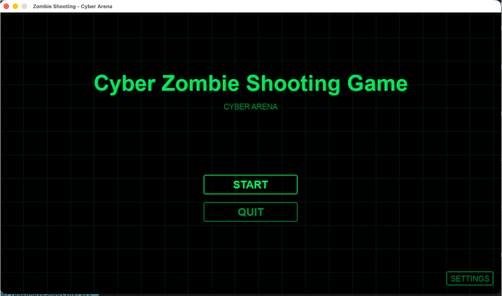
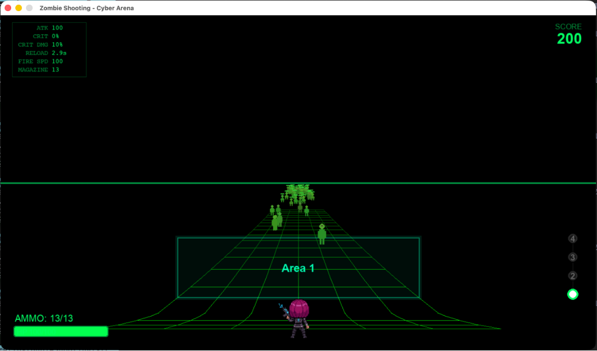

# Cyber Zombie Shooting Game

サイバー空間を舞台にした疑似3Dゾンビシューティングゲーム。

## 概要

PythonとPygameを用いて制作した、疑似3DのTPSゾンビシューティングゲームです。

プレイヤーはサイバー空間へ飛び込み、
エリアを攻略しながらゾンビを倒し、
バフオーブを獲得してステータスを強化し、
より強いエリアへ進んでいきます。

## スクリーンショット





## 特徴

- 疑似3DによるTPS視点
- エリア進行制（Wave制ではなく空間を前進する）
- バフオーブシステム（ゾンビ撃破でランダムバフ獲得）
- サイバー空間風デザイン（ネオングリッド、バイナリパーティクル）
- シード固定によるランダム生成エリア
- スコアシステム（撃破・制圧・ペナルティ）
- BGM・効果音対応、音量設定の永続化

## 操作方法

| キー | 動作 |
|------|------|
| W | 前進 |
| A | 左移動 |
| D | 右移動 |
| Space（長押し） | 射撃（連射） |
| R | リロード |
| ESC | ポーズ |

## 動作環境

- macOS
- Python 3.13 以上
- pygame 2.x

## インストール

```bash
git clone https://github.com/rny012357/TPS-Zombie-Shooting.git
cd TPS-Zombie-Shooting
python -m venv .venv
source .venv/bin/activate
pip install -r requirements.txt
```

## 実行方法

```bash
source .venv/bin/activate
python src/main.py
```

## ディレクトリ構成

```text
TpsZonbieShooting/
├── docs/                         # ドキュメント
│   ├── specs/                    # 要件定義・仕様書
│   │   ├── 要件定義.md
│   │   ├── 追加要件・仕様変更1.md
│   │   ├── 追加要件・仕様変更2.md
│   │   ├── 追加要件・仕様変更3.md
│   │   ├── 追加要件・仕様変更4.md
│   │   ├── 追加要件・仕様変更4(改訂).md
│   │   └── 追加要件・仕様変更5.md
│   ├── game_scene.png            # ゲームプレイ画面
│   └── home_scene.png            # ホーム画面
├── src/
│   ├── assets/
│   │   ├── images/               # スプライト画像
│   │   └── sounds/               # BGM・効果音
│   ├── main.py                   # エントリーポイント
│   ├── config.py                 # 全定数定義
│   ├── scene_manager.py          # シーン管理（Scene基底 + SceneManager）
│   ├── home_scene.py             # ホーム画面
│   ├── game_scene.py             # ゲームプレイシーン
│   ├── pause_scene.py            # ポーズ画面
│   ├── settings_scene.py         # 設定画面（音量スライダー）
│   ├── settings_manager.py       # 設定ファイル管理（settings.json）
│   ├── asset_manager.py          # アセット一括ロード
│   ├── sound_manager.py          # BGM・SE再生制御
│   ├── game_object.py            # ゲームオブジェクト基底クラス
│   ├── player.py                 # プレイヤー
│   ├── bullet.py                 # 銃弾
│   ├── zombie.py                 # ゾンビ（AI付き）
│   ├── area.py                   # エリアシステム
│   ├── buff_system.py            # バフ抽選・バフオーブ
│   ├── buffs.json                # バフ定義データ（外部JSON）
│   ├── effects.py                # エフェクト（パーティクル・シェイク等）
│   └── ui.py                     # HUD描画
├── requirements.txt
├── .gitignore
└── README.md
```

## プロジェクト構成

```text
SceneManager ─── HomeScene
              ├── GameScene
              ├── PauseScene
              └── SettingsScene

AssetManager（シングルトン: 画像・音声の一括キャッシュ）
SettingsManager（シングルトン: settings.json 永続化）
SoundManager（シングルトン: BGM/SE再生・音量制御）

GameScene
 ├── Player（プレイヤー操作・ステータス・バフ適用）
 ├── Bullet（弾丸・直進・射程管理）
 ├── Zombie（敵AI: idle ↔ tracking）
 ├── AreaManager → Area → AreaGate（エリア進行）
 ├── BuffOrb（バフオーブ: 抽選・飛行・取得）
 ├── EffectManager（パーティクル・マズルフラッシュ・シェイク）
 └── UI（HPバー・残弾・スコア・ステータス・エリアマップ）
```

## 使用ライブラリ

- [pygame](https://www.pygame.org/) — ゲーム描画・入力・サウンド
- json — バフ定義・設定ファイルの読み書き
- random — ゾンビ配置・バフ抽選・エフェクト生成
- math — 透視変換・パーティクル軌道計算
- os — ファイルパス管理

## 開発状況

- [x] 疑似3D描画（透視変換・スケーリング）
- [x] ゾンビAI（待機→追跡の2状態）
- [x] エリアシステム（シード固定・先読み生成）
- [x] バフシステム（JSON駆動・レアリティ抽選）
- [x] ホーム画面
- [x] ポーズ画面
- [x] 設定画面（音量スライダー）
- [x] サウンドシステム（BGM・SE・音量永続化）
- [x] エフェクト（バイナリパーティクル・マズルフラッシュ・シェイク）
- [x] プレイヤースプライト
- [ ] 新しい敵の種類の追加
- [ ] ボス戦
- [ ] 新しい武器
- [ ] セーブ機能
- [ ] エフェクト強化

## 今後の予定

- 新しい敵の種類の追加
- ボス戦の実装
- 新しい武器の追加
- セーブ機能
- エフェクトのさらなる強化

## Assets

本プロジェクトで使用している画像・音声などのアセットの著作権は、それぞれの権利者に帰属します。

各アセットは、それぞれのライセンスおよび利用規約に従って使用しています。